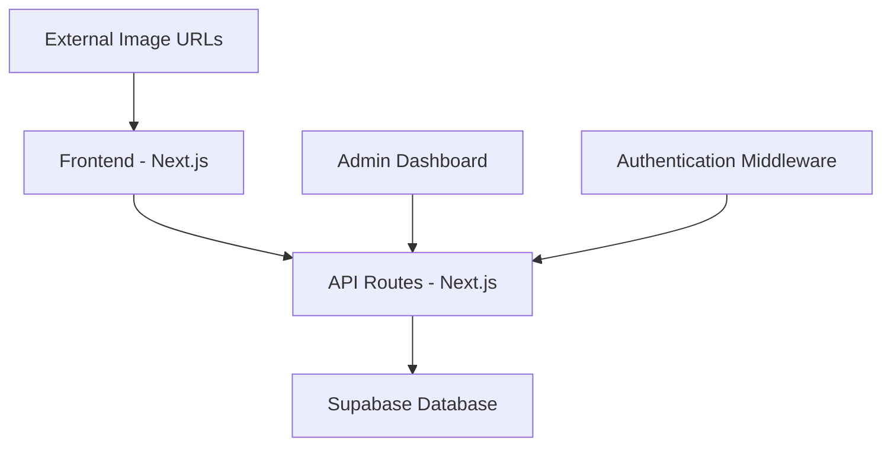

# Design Document

## Overview

The admin dashboard and backend system will transform the static Pixel Perfection website into a dynamic e-commerce platform. The solution includes a secure authentication system, RESTful API endpoints, database integration, and a modern admin interface built with shadcn/ui components.

## Architecture

### System Architecture


### Technology Stack
- **Database**: Supabase (PostgreSQL with real-time features)
- **ORM**: Prisma with Supabase adapter for type-safe database operations
- **Authentication**: NextAuth.js with credentials provider
- **Image Storage**: External image URLs (no file upload needed)
- **API**: Next.js API routes with middleware for authentication
- **Admin UI**: shadcn/ui dashboard-01 template

## Components and Interfaces

### Database Schema

#### Products Table
```sql
CREATE TABLE products (
  id TEXT PRIMARY KEY,
  title TEXT NOT NULL,
  description TEXT,
  price DECIMAL(10,2) NOT NULL,
  imageUrl TEXT,
  tags TEXT[], -- JSON array for SQLite
  category TEXT,
  inStock BOOLEAN DEFAULT true,
  createdAt DATETIME DEFAULT CURRENT_TIMESTAMP,
  updatedAt DATETIME DEFAULT CURRENT_TIMESTAMP
);
```

#### Site Settings Table
```sql
CREATE TABLE site_settings (
  key TEXT PRIMARY KEY,
  value TEXT NOT NULL,
  updatedAt DATETIME DEFAULT CURRENT_TIMESTAMP
);
```

#### Admin Users Table
```sql
CREATE TABLE admin_users (
  id TEXT PRIMARY KEY,
  username TEXT UNIQUE NOT NULL,
  password TEXT NOT NULL, -- hashed
  role TEXT DEFAULT 'admin',
  createdAt DATETIME DEFAULT CURRENT_TIMESTAMP
);
```

### API Endpoints

#### Public API Routes
- `GET /api/products` - Fetch all products
- `GET /api/products/[id]` - Fetch single product
- `GET /api/settings` - Fetch public site settings

#### Admin API Routes (Protected)
- `POST /api/admin/products` - Create product
- `PUT /api/admin/products/[id]` - Update product
- `DELETE /api/admin/products/[id]` - Delete product
- `GET /api/admin/analytics` - Dashboard metrics
- `PUT /api/admin/settings` - Update site settings

#### Authentication Routes
- `POST /api/auth/signin` - Admin login
- `POST /api/auth/signout` - Admin logout
- `GET /api/auth/session` - Check session status

### Admin Dashboard Structure

#### Layout Components
```
/dashboard
├── layout.tsx          # Dashboard layout with sidebar
├── page.tsx           # Dashboard home with metrics
├── products/
│   ├── page.tsx       # Products list
│   ├── new/page.tsx   # Add product form
│   └── [id]/page.tsx  # Edit product form
├── settings/
│   └── page.tsx       # Site settings
└── analytics/
    └── page.tsx       # Analytics dashboard
```

#### Dashboard Features
- **Sidebar Navigation**: Products, Analytics, Settings, Logout
- **Product Management**: CRUD operations with external image URL input
- **Analytics Cards**: Total products, recent activity, system status
- **Settings Panel**: Site information, FAQ management
- **Responsive Design**: Mobile-friendly interface

## Data Models

### Product Model
```typescript
interface Product {
  id: string;
  title: string;
  description: string;
  price: number;
  imageUrl: string;
  tags: string[];
  category: string;
  inStock: boolean;
  createdAt: Date;
  updatedAt: Date;
}
```

### Site Settings Model
```typescript
interface SiteSettings {
  siteName: string;
  siteDescription: string;
  contactEmail: string;
  storeAddress: string;
  socialLinks: {
    instagram?: string;
    whatsapp?: string;
  };
}
```

### Admin User Model
```typescript
interface AdminUser {
  id: string;
  username: string;
  role: 'admin' | 'editor';
  createdAt: Date;
}
```

## Error Handling

### API Error Responses
```typescript
interface APIError {
  error: string;
  message: string;
  statusCode: number;
  timestamp: string;
}
```

### Error Scenarios
- **401 Unauthorized**: Invalid credentials or expired session
- **403 Forbidden**: Insufficient permissions
- **404 Not Found**: Resource doesn't exist
- **422 Unprocessable Entity**: Validation errors
- **500 Internal Server Error**: Database or server errors

### Client-Side Error Handling
- Toast notifications for user feedback
- Form validation with error messages
- Retry mechanisms for failed requests
- Graceful fallbacks for missing data

## Testing Strategy

### Unit Tests
- API route handlers
- Database operations
- Authentication middleware
- Utility functions

### Integration Tests
- Complete API workflows
- Authentication flows
- File upload processes
- Database migrations

### E2E Tests
- Admin login process
- Product CRUD operations
- External image URL validation
- Dashboard navigation

### Test Data
- Seed database with sample products
- Mock authentication for testing
- Test external image URLs

## Security Considerations

### Authentication
- Password hashing with bcrypt
- Session-based authentication
- CSRF protection
- Rate limiting on login attempts

### Authorization
- Role-based access control
- API route protection middleware
- Admin-only endpoints validation

### Data Validation
- Input sanitization
- File upload restrictions
- SQL injection prevention
- XSS protection

### URL Validation
- Image URL format validation
- External URL accessibility checks
- Malicious URL prevention

## Performance Optimizations

### Database
- Indexed queries for products
- Connection pooling
- Query optimization

### Caching
- API response caching
- Static asset caching
- Database query caching

### Image Handling
- External URL validation
- Image loading optimization
- Lazy loading
- Fallback images for broken URLs